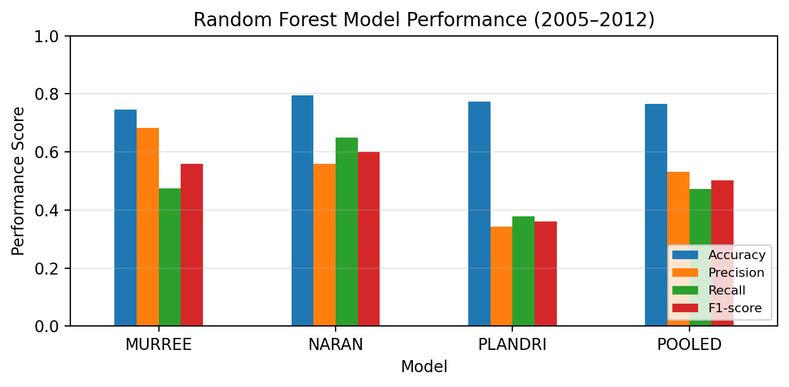
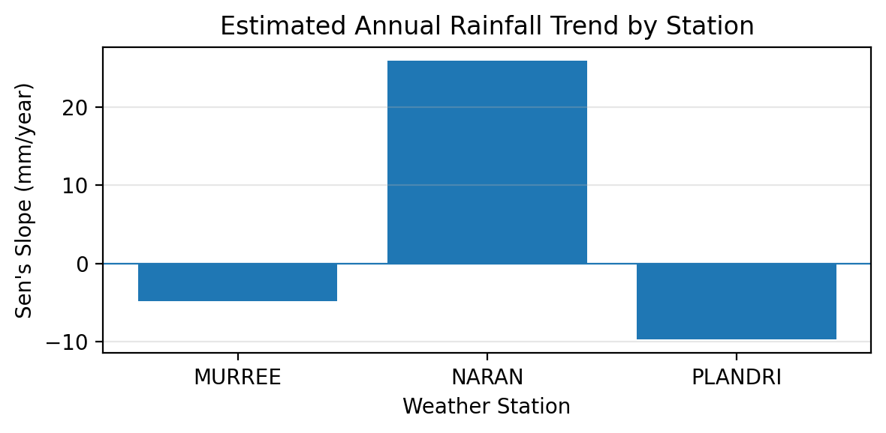
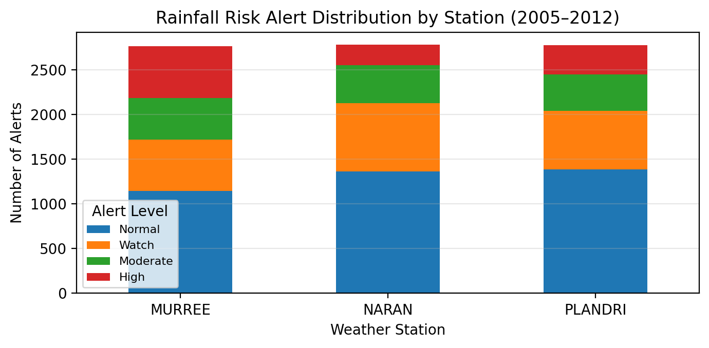

# **Rain-Guard Agent: Project**

Yasir Rauf

Faculty of Arts and Sciences (FAS), Aga Khan University (AKU), Karachi, Pakistan

**Student ID:** 593752

**Assigned Station:** MURREE, NARAN, PLANDRI

**Random seed:** 3752

**Training Period:** 1971–2004

**Testing Period:** 2005–2012

Following the five-layer K-WaterGuard structure from the workshop (configure, perceive, reason, act, orchestrate), this project builds Rain-Guard, a daily rainfall-risk agent for MURREE, NARAN, and PLANDRI using seed 3752 and a 1971–2004 training / 2005–2012 testing split. It cleans station weather data, forecasts next-day rain alongside annual precipitation trends, and assigns alert tiers with clear actions. Everything runs from a single command to produce a status file and a chart, supported by automated tests, a highest-tier scorecard, and a human-approval safeguard.

## 1. Configure and Perceive: Data Preparation

The project used the supplied daily weather dataset (1971–2012), containing precipitation, maximum and minimum temperature, station identifiers, and rainfall labels. The three assigned stations were selected using the student-ID procedure.

Data quality control replaced temperature placeholders and negative precipitation values with missing values. Monthly median absolute deviation (MAD) was used to flag potential outliers without automatically deleting extreme observations. Missing weather predictors were imputed using training-period medians.

The original rainfall label was reconstructed using precipitation on the following calendar day. Observations without a consecutive next-day record or valid next-day precipitation were excluded. This ensured that the prediction target represented next-day rainfall rather than same-day rainfall.

Five predictors were used: precipitation, maximum temperature, minimum temperature, and seasonal sine and cosine terms. The final dataset contained **35,410 training observations** and **8,327 testing observations**. The training and testing periods were kept chronological, with no overlap.

## 2. Reason: Model Development and Evaluation

Four Random Forest models were developed: one for each station and one pooled model trained on all three stations. Models used 100 trees, a fixed random seed of 3752, and balanced class weights.

### Table 1. Random Forest Model Performance on the Testing Period

| Model   |   Accuracy |   Precision |   Recall |   F1-score |
|:--------|-----------:|------------:|---------:|-----------:|
| MURREE  |      0.747 |       0.682 |    0.474 |      0.559 |
| NARAN   |      0.794 |       0.558 |    0.650 |      0.601 |
| PLANDRI |      0.774 |       0.344 |    0.378 |      0.360 |
| POOLED  |      0.766 |       0.532 |    0.473 |      0.501 |

NARAN achieved the highest F1-score (0.601), followed by MURREE (0.559), the pooled model (0.501), and PLANDRI (0.360). PLANDRI's comparatively low precision and recall indicate weaker identification of next-day rainfall events.



*Figure 1. Accuracy, precision, recall, and F1-score for the four models.*

### Unseen-station generalization

A separate model was trained using MURREE and NARAN and evaluated exclusively on PLANDRI, which was excluded from training. It achieved **0.823 accuracy, 0.449 precision, 0.224 recall, and 0.299 F1-score**. Although overall accuracy was relatively high, the low recall demonstrates limited detection of rainfall events at an unseen station.

## 3. Reason: Historical Rainfall Trend Analysis

Annual precipitation totals were analysed for 42 years per station using Kendall's tau-based trend testing and Sen's slope. Years with less than 90% daily observation coverage were excluded.

### Table 2. Annual Rainfall Trend Results

| Station   |   Years analysed |   Kendall's tau |   p-value |   Sen's slope (mm/year) | Trend                |
|:----------|-----------------:|----------------:|----------:|------------------------:|:---------------------|
| MURREE    |               42 |          -0.108 |     0.314 |                  -4.836 | No significant trend |
| NARAN     |               42 |           0.260 |     0.015 |                  25.930 | Increasing           |
| PLANDRI   |               42 |          -0.249 |     0.020 |                  -9.700 | Decreasing           |

NARAN showed a statistically significant increasing trend, while PLANDRI showed a statistically significant decreasing trend. MURREE had no statistically significant trend at the 0.05 level.



*Figure 2. Sen's estimated annual precipitation trend slopes. Positive values indicate increasing rainfall and negative values indicate decreasing rainfall.*

These findings describe historical associations, not causes or future rainfall projections. Conventional significance estimates may also be affected by serial correlation in annual precipitation.

## 4. Act: Risk Classification and Alert Evaluation

Predicted rainfall probabilities were classified into four tiers: Normal, Watch, Moderate, and High. Station-specific thresholds were calibrated using training-period validation data and stored in `config.py`. Each tier has a corresponding recommended action.



*Figure 3. Distribution of the four rainfall-risk alert levels across the three stations during testing.*

### Table 3. Overall High-Alert Performance (2005–2012)

| Measure | Result |
|---|---:|
| True positives | 701 |
| False positives | 440 |
| True negatives | 5,819 |
| False negatives | 1,367 |
| Hit rate | 0.339 |
| False-alarm rate | 0.070 |
| Miss rate | 0.661 |

The High-alert tier captured 33.9% of actual rainfall events, while its false-alarm rate was 7.0%. Its 66.1% miss rate indicates that many rainfall events did not reach the highest alert tier. Therefore, High alerts should support, not replace, other forecasting and monitoring arrangements.

**Human approval safeguard:** A designated meteorological officer must review and approve every High alert before public dissemination or operational action. This safeguard addresses the consequences of false warnings and missed rainfall events.

## 5. Orchestrate: Execution and Outputs

The five layers are integrated in `run_agent.py`. The complete pipeline executes with one command:

```bash
python run_agent.py
```

Seven automated tests passed, covering temperature placeholders, negative precipitation, next-day target alignment, chronological splitting, target leakage, alert classification, and status-file generation.

Generated outputs include `status.json`, rainfall alerts, the rainfall-risk chart, model evaluation, rainfall trends, the High-alert scorecard, and quality-control, outlier, and imputation logs.

## 6. Limitations and AI Use

Missing precipitation predictors were imputed using training-period medians of zero, which may affect dry-day representation. Statistical outliers were flagged rather than assumed to be errors. The unseen-station experiment and High-alert scorecard demonstrate that the agent has limitations in detecting rainfall events. Its alerts require human review and should not be interpreted as a standalone operational warning system.

**AI use statement:** ChatGPT was used to assist with code structuring, debugging, and clarity. Data processing, model execution, evaluation, interpretation, and final review were conducted by the student.
